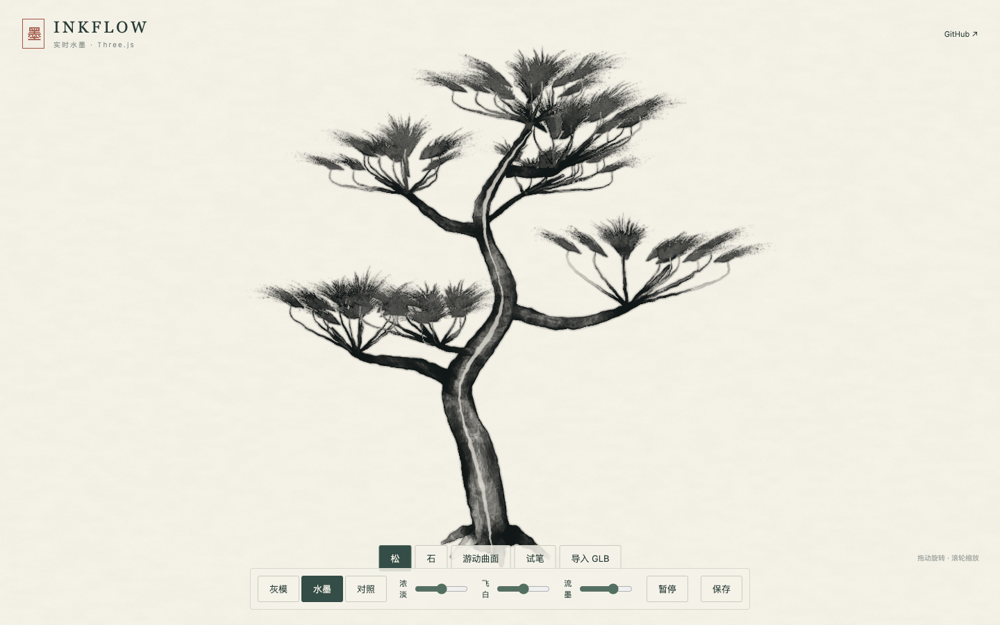

# INKFLOW · 实时水墨

**从灰模到笔墨。** A reusable ink brush and rendering toolkit for Three.js: concentrated ink masses, bristle marks, dry-brush gaps, reserved paper, broken outlines, and animated surface ink flow.



[在线演示](https://ryeblablabla.github.io/inkflow/) · [English](README.en.md) · [渲染结构](guide/architecture.md)

## 能做什么

- **三维水墨**：以几何、法线、遮蔽和表面笔势组织墨色。无需模型 UV 或水墨底色贴图。
- **毛刷与飞白**：表面固定的笔触，有独立墨量、笔压、刷毛覆盖和浓淡分离；共用的通用笔刷遮罩可替换。
- **实时流墨**：模型空间方向场与双相位推进。幅度、速度可调，可暂停、继续或固定时间回放。
- **骨骼动画**：静态网格和 `SkinnedMesh` 共用管线。笔触锚点通过三角面重心坐标保留三个顶点的全部骨骼影响，跟随变形。
- **二维试笔**：独立的 `InkBrushCanvas`，支持鼠标、触控、压感、行笔速度、干湿与 PNG 导出。

这是共享渲染器加可选艺术指导的工具，不会自动理解原画，也不把一幅水墨画贴回物体。局部三维留白曲线和材料类别参数可用于主角或重要物件。流墨是程序材质输运，不是守恒的液膜、滴落或碰撞流体模拟。

## 本地运行

Node.js 20.19+ 或 22.12+。

```sh
npm install
npm run dev
```

打开终端给出的地址。示例包含程序生成的石、松、骨骼游动曲面和二维试笔，可导入自己的 `.glb`。带动作的 GLB 会播放第一组动画。

```sh
npm run build
npm run preview
```

## 接入 Three.js

```js
import * as THREE from 'three';
import { InkWashRenderer, loadInkResources } from './src/index.js';

const ink = new InkWashRenderer(renderer, {
  outline: .55,
  inkFlow: .68,
  inkFlowSpeed: .8,
});
ink.setSharedResources(await loadInkResources('/ink/'));
ink.register(model, {
  flow: new THREE.Vector3(0, 0, 1),
  reserveDirection: new THREE.Vector3(0, -1, 0),
  reserveStrength: .3,
});

function resize() {
  const size = renderer.getDrawingBufferSize(new THREE.Vector2());
  ink.setSize(size.x, size.y);
}
function frame(deltaSeconds) {
  mixer?.update(deltaSeconds); // 骨骼动画先于水墨渲染
  ink.advance(deltaSeconds);
  ink.render(scene, camera); // 或 { mode: 'gray' | 'compare', split: .5 }
}
```

`loadInkResources()` 的目录包含 `public/ink/` 下的两张共用 PNG。它们只有通用刷痕与纸纹/噪声，没有角色图案和原画颜色。可不加载资源，使用程序笔触；或通过 `setSharedResources()` 提供自己的笔刷。

```js
ink.configure({ density: 1.2, dry: .6, tonalContrast: .95, tonalSoftness: .025 });
ink.setMotionPaused(true);
ink.setTime(3);
ink.unregister(model); // 恢复注册前的几何与材质
ink.dispose();
```

每个网格可通过 `mesh.userData.inkProfile` 覆盖流向、浓淡范围、留白、曲率、积墨和少量三维 `brushPaths`。完整字段与边界见[渲染结构](guide/architecture.md)。

## 二维画笔

```js
import { InkBrushCanvas } from './src/index.js';
const brush = new InkBrushCanvas(canvas, { size: 36, dry: .5, wet: .55 });
brush.configure({ density: 1.3, dry: .8 });
brush.clear();
brush.dispose();
```

## 当前边界

面向 WebGL2 和不透明网格。几何分析在注册时进行，骨骼动画复用静止姿态分析结果；大幅变形不会重新计算动态自遮蔽。表面笔触的几何定位跟随骨骼，方向框架使用线性混合近似。尚不支持形态键、透明物体、运行时改拓扑或完整物理流体。当前版本是研究工具，手机与大量角色同屏的帧耗需要在目标设备测量。

演示视频中的应龙来自《潜鳞》项目，包含修复、绑定与分层动作。**龙模型、原设图、游戏工程与原始贴图不随本仓库分发**；公共示例使用本仓库原创程序几何，可换成自己的模型。视频中的水墨画面由实际三维渲染输出采集。

## 许可证与来源

原创代码和程序几何采用 [MIT](LICENSE)。Three.js 与 three-mesh-bvh 采用 MIT；可选 KinoAqua 后处理源自 Unlicense 项目。通用笔刷资源来自 David Revoy 的 Krita 2023-01 bundle，采用 CC0。详见 [THIRD-PARTY.md](THIRD-PARTY.md)。

项目不要求云服务或生成模型 API。示例可完全在本地运行。
